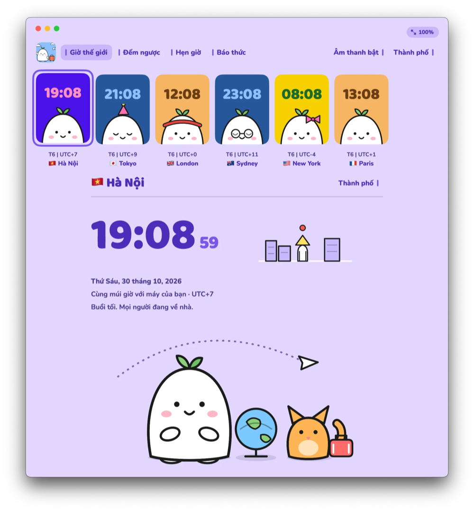
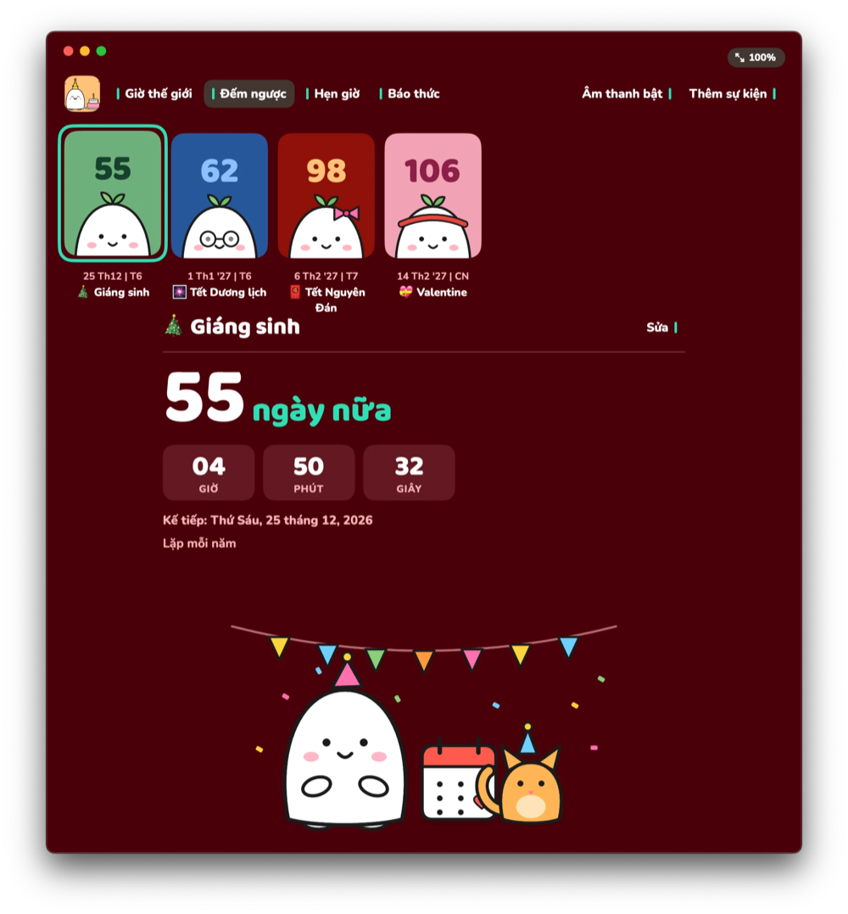
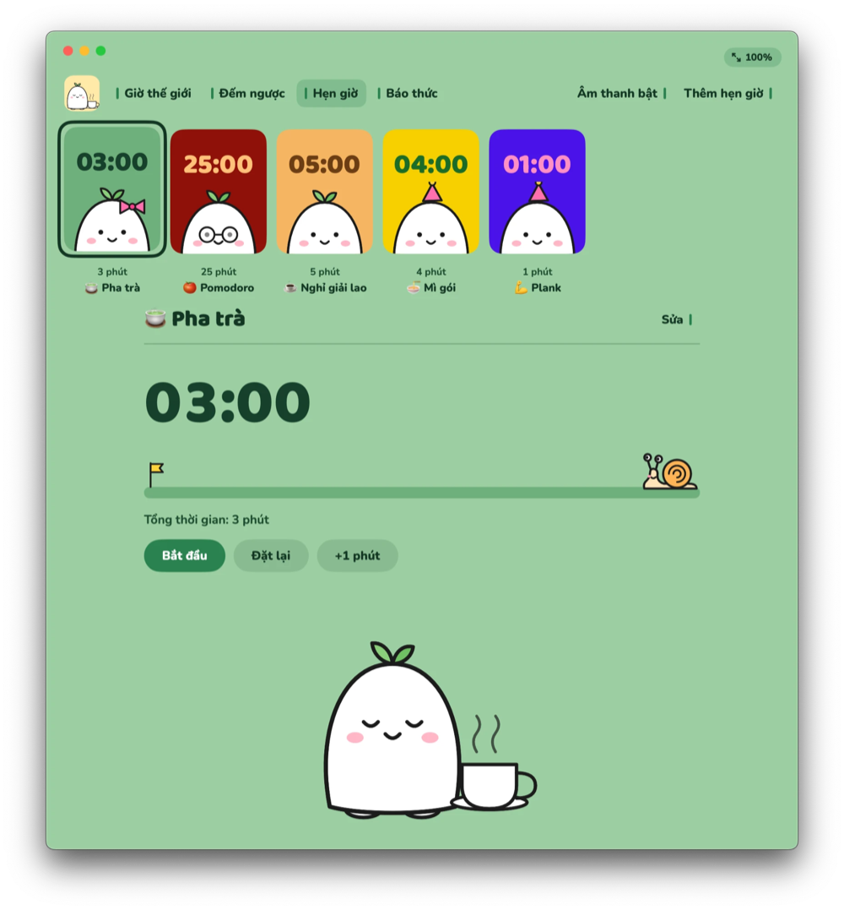
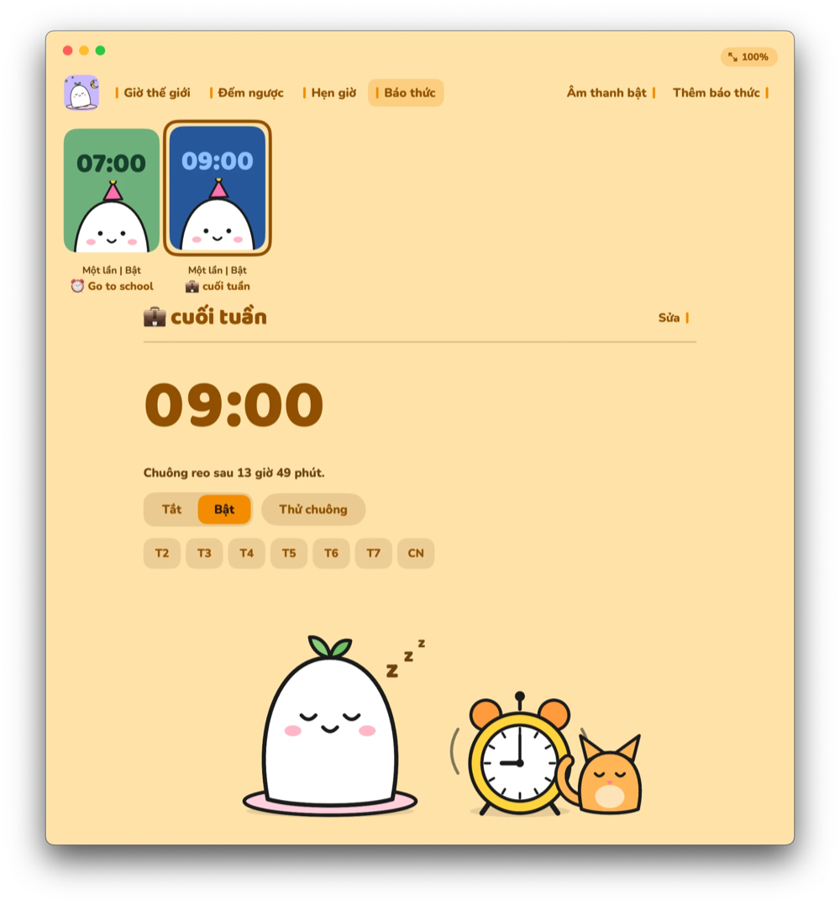
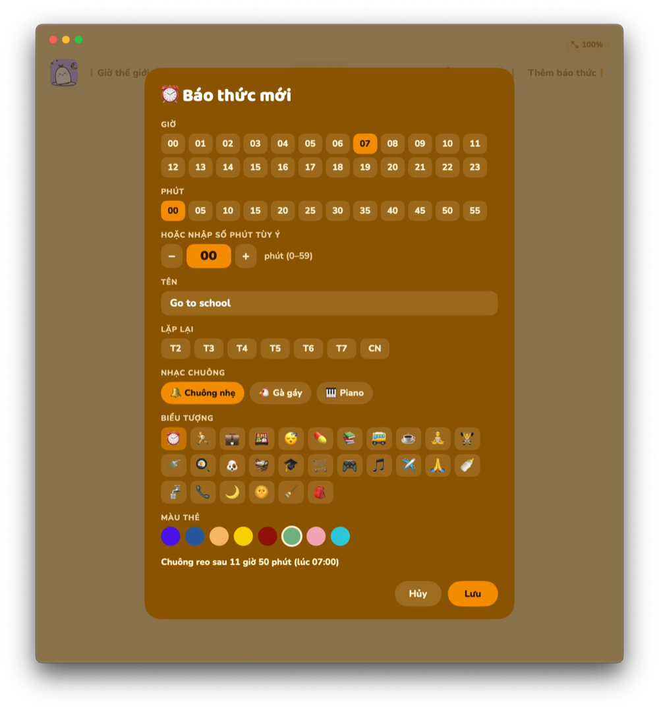
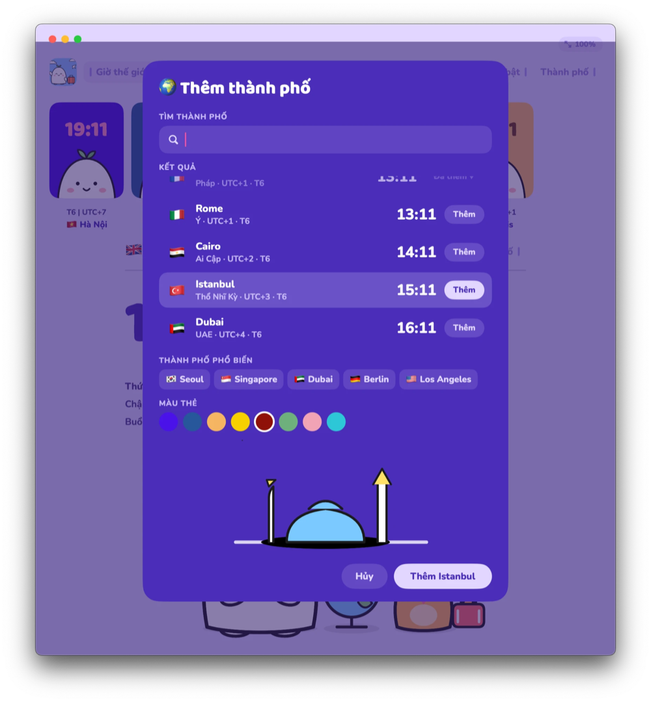
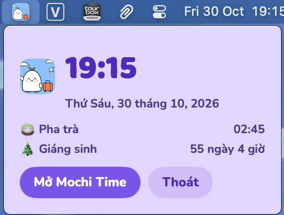

# Mochi Time – Releases

🍡 **Mochi Time** là app macOS gồm 4 tính năng về thời gian, gói gọn trong một chú bánh dẻo (mochi) hiền lành và dễ thương:

- 🌏 **Giờ thế giới**: xem giờ nhiều thành phố, Mochi sẽ ngủ khi thành phố đó đang ban đêm.
- 🎉 **Đếm ngược**: đếm ngược đến những ngày bạn mong chờ.
- ⏱️ **Hẹn giờ**: chạy nhiều bộ hẹn giờ cùng lúc, hết giờ Mochi sẽ báo bạn.
- ⏰ **Báo thức**: báo thức lặp lại với nhạc chuông dịu nhẹ.

🍡 **Mochi Time** is a macOS app with 4 time tools, wrapped up in one gentle, cute little mochi:

- 🌏 **World clock**: see the time in several cities; Mochi falls asleep when it's night there.
- 🎉 **Countdown**: count down to the days you're looking forward to.
- ⏱️ **Timer**: run several timers at once; Mochi lets you know when time's up.
- ⏰ **Alarm**: repeating alarms with soft, gentle ringtones.

## Ảnh chụp màn hình / Screenshots

<table>
<tr>
<td align="center"><br><sub><b>Giờ thế giới: xem giờ nhiều thành phố</b><br>World clock: see the time in several cities</sub></td>
<td align="center"><br><sub><b>Đếm ngược: đếm đến những ngày bạn mong chờ</b><br>Countdown: count down to the days you look forward to</sub></td>
</tr>
<tr>
<td align="center"><br><sub><b>Hẹn giờ: nhiều bộ hẹn giờ cùng lúc</b><br>Timer: several timers at once</sub></td>
<td align="center"><br><sub><b>Báo thức: danh sách báo thức của bạn</b><br>Alarm: your list of alarms</sub></td>
</tr>
<tr>
<td align="center"><br><sub><b>Báo thức mới: chọn giờ, lặp lại, nhạc chuông</b><br>New alarm: pick time, repeat days and ringtone</sub></td>
<td align="center"><br><sub><b>Thêm thành phố: tìm nhanh trên toàn thế giới</b><br>Add city: quick search across the world</sub></td>
</tr>
<tr>
<td align="center"><br><sub><b>Thanh menu: xem nhanh giờ, hẹn giờ và đếm ngược</b><br>Menu bar: quick view of the time, timers and countdowns</sub></td>
<td></td>
</tr>
</table>

## Tiếng Việt

Bản dựng macOS của Mochi Time (cần macOS 14 trở lên). Tải file `.dmg` mới nhất ở mục **Releases**.

**Cài đặt**
1. Mở file `.dmg`, **kéo thả** **Mochi Time** vào thư mục **Applications**.
2. Lần đầu mở app sẽ bị macOS chặn vì chưa được Apple notarize. Cách xử lý nhanh nhất là gỡ cờ cách ly bằng Terminal:
   - Mở **Terminal**, gõ `xattr -cr ` (có **dấu cách ở cuối**, chưa bấm Enter).
   - Mở thư mục **Applications**, **kéo thả** file **Mochi Time** vào cửa sổ Terminal, đường dẫn sẽ tự điền. Lệnh hoàn chỉnh trông như sau:
     ```
     xattr -cr "/Applications/Mochi Time.app"
     ```
   - Bấm **Enter**, rồi mở Mochi Time bình thường.
3. Hoặc không dùng Terminal:
   - **macOS 15 trở lên**: bấm **Done**, vào **System Settings → Privacy & Security**, kéo xuống bấm **Open Anyway** ở dòng Mochi Time, rồi xác nhận.
   - **macOS 14**: chuột phải vào app trong Applications, chọn **Mở**.

- Các bản sau app tự cập nhật.
- `latest.json` là file thông tin phiên bản để app kiểm tra cập nhật.
- Repo này chỉ chứa bản dựng, không chứa mã nguồn.

## English

macOS builds of Mochi Time (requires macOS 14 or later). Download the latest `.dmg` from **Releases**.

**Install**
1. Open the `.dmg` and **drag** **Mochi Time** into the **Applications** folder.
2. On first launch macOS blocks the app because it is not notarized by Apple. The quickest fix is to clear the quarantine flag in Terminal:
   - Open **Terminal** and type `xattr -cr ` (with a **trailing space**, don't press Enter yet).
   - Open the **Applications** folder and **drag** the **Mochi Time** app into the Terminal window; its path is filled in for you. The full command looks like this:
     ```
     xattr -cr "/Applications/Mochi Time.app"
     ```
   - Press **Enter**, then open Mochi Time as usual.
3. Or without Terminal:
   - **macOS 15 or later**: click **Done**, go to **System Settings → Privacy & Security**, scroll down and click **Open Anyway** next to Mochi Time, then confirm.
   - **macOS 14**: right-click the app in Applications and choose **Open**.

- Later versions update themselves.
- `latest.json` is the version info file the app reads to check for updates.
- This repo contains builds only, not the source code.
